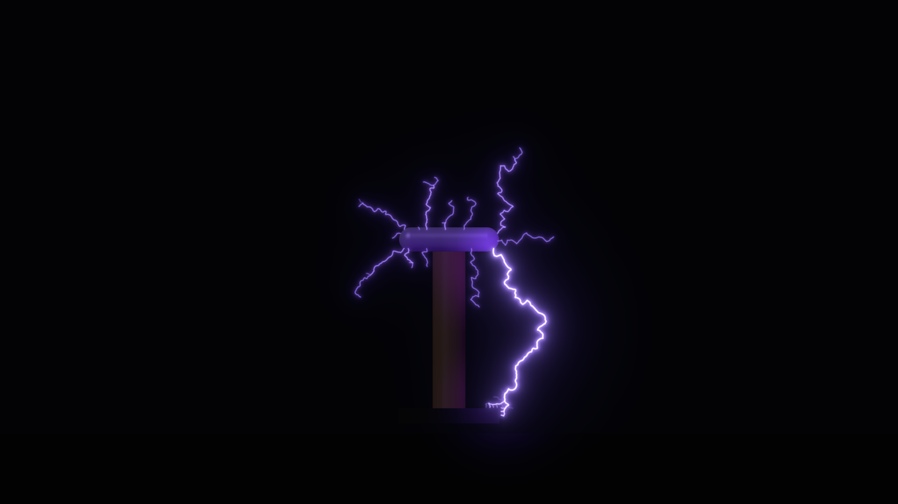
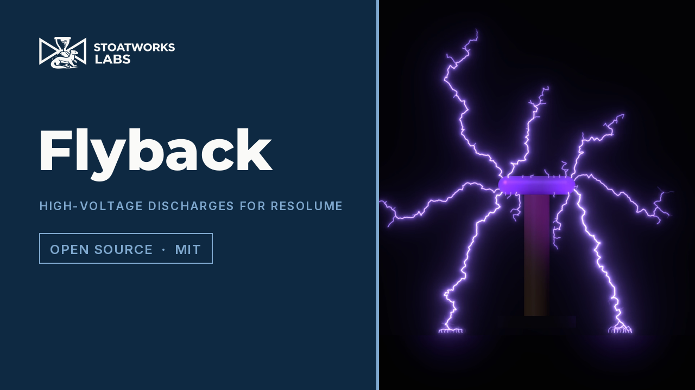
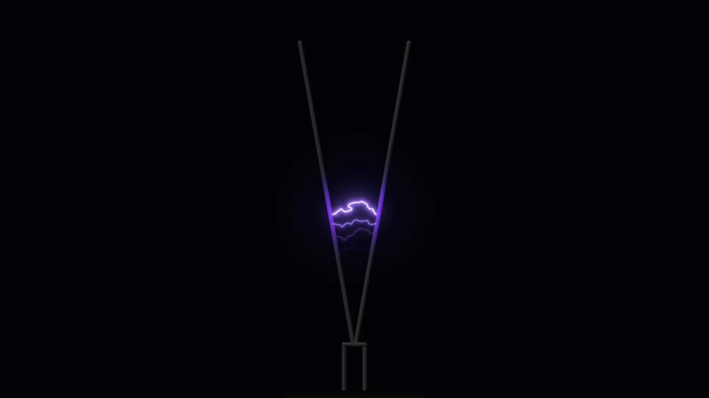
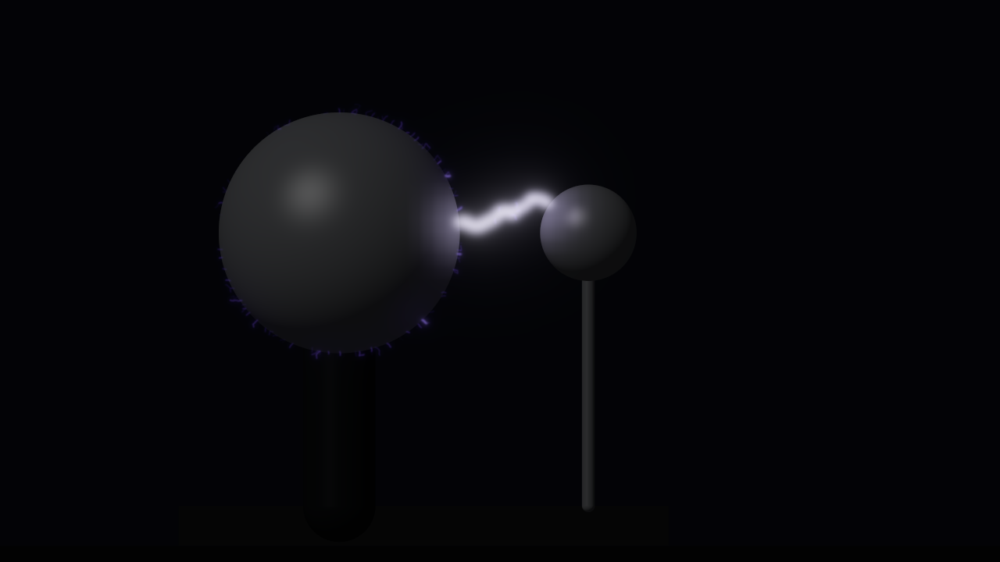
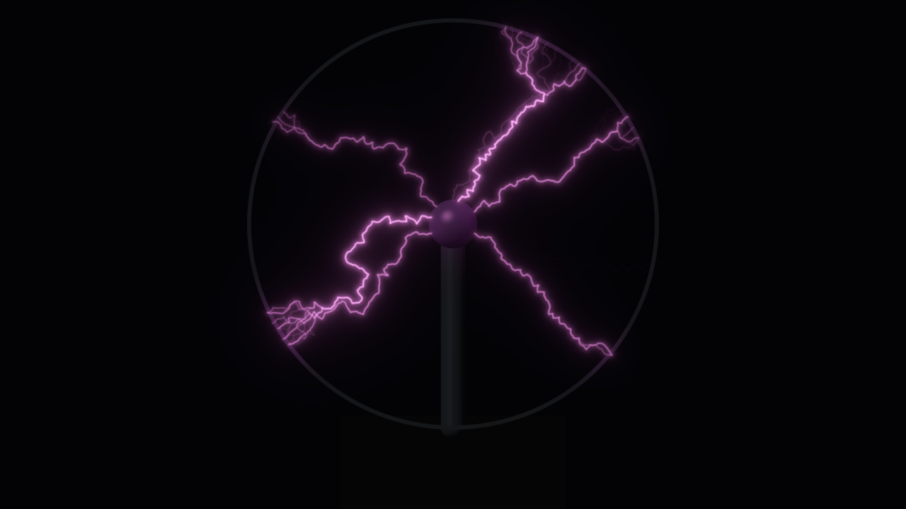
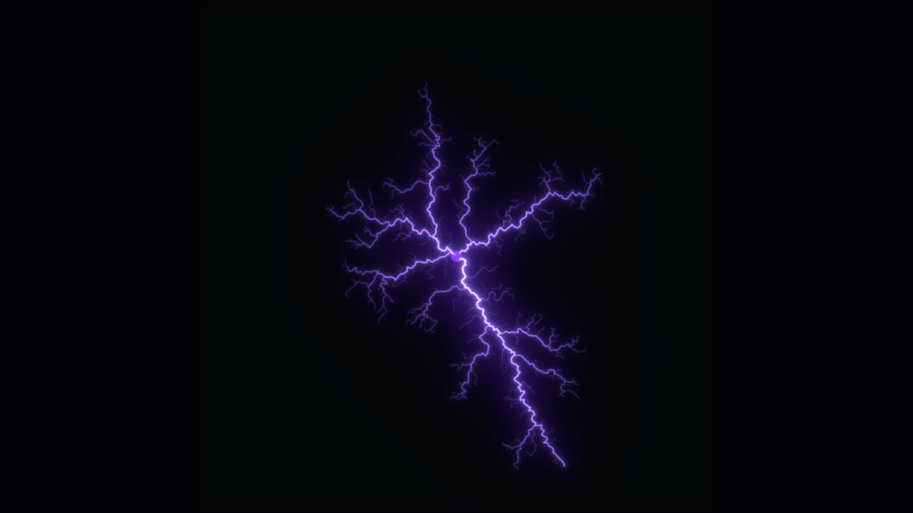
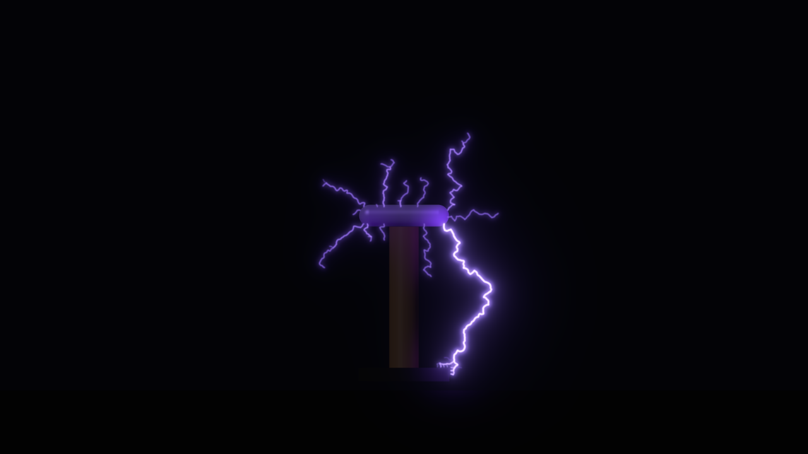
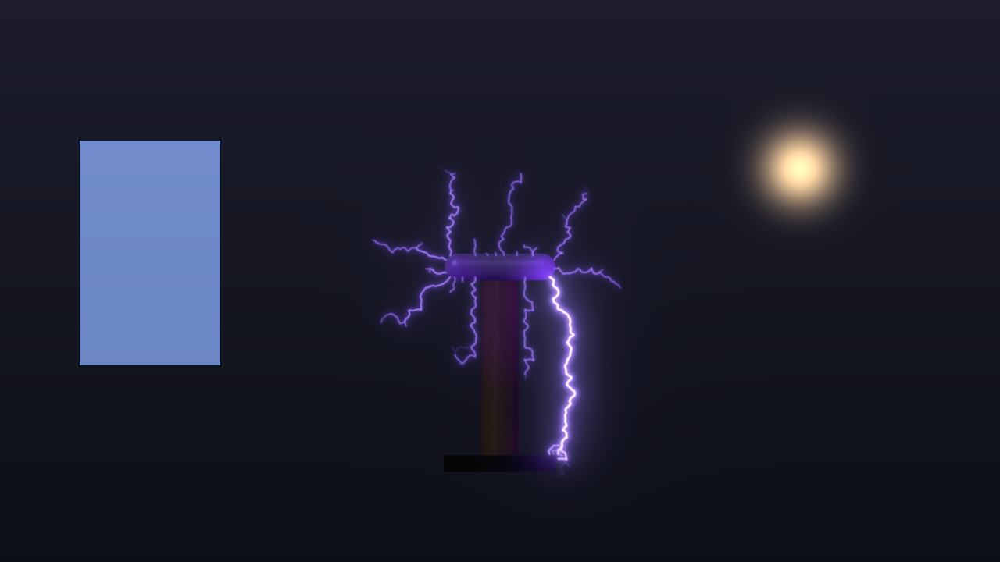

# flyback

> **AI-assisted project.** This codebase was created with [Claude](https://claude.com/claude-code)
> (Anthropic), directed and reviewed by a human author. It loads, registers and renders in
> Resolume Arena on macOS (one short session) and on Windows (on software rendering), and
> Resolume's audio reaches it on the Mac. The singing coil has never heard a real input there.
> Everything else is measured by an offline harness that drives the real plugin class in a
> headless GL context, or the engine on its own where a claim doesn't need a GPU, and every
> check is also run against a wrong model to make sure it can tell. The numbers, and the list
> of what I haven't tried yet, are under [Status](#status).

The high-voltage corner of a science museum, for Resolume Arena and Avenue: a Jacob's ladder, a
Tesla coil, a Van de Graaff generator, a plasma globe and a Lichtenberg figure. It comes as two
FFGL plugins, a source (`SW Flyback`) and an effect that strikes into your clip
(`SW Flyback Over`), and nobody has to stand behind the cage.

> **Photosensitivity.** The singing coil (new in v0.2.0) strikes at the pitch of whatever it
> hears, so busy music makes busy strikes, and through `SW Flyback Over` every strike lights the
> clip. I measured it over the audio of Resolume's eighteen demo clips, counting flashes in the
> whole frame and in every third of it. At the defaults it stays well under **three flashes a
> second**, the line broadcast and web (WCAG) guidance draw: the singing source flashed none over
> the whole frame and at most 0.5 a second in a third of it, and the Over effect added at most
> half a flash a second to the clip's own. Pushed (Efficiency at 10%, Gate at −30 dBFS, the coil
> at Scale ×2, and Illumination ×40 for the Over), the busiest demo beats and the browser demo's
> test tune reached **2.5** (source), and the beats **3.0** (Over), flashes a second in a third of
> the frame: at the line, not past it, and louder, faster or denser music than the demo clips can
> go further. Flashing like that can trigger seizures in people with photosensitive epilepsy. The
> BPS mode, v0.1.0's, stayed at or under one a second at every rate tried. See
> [Flashing](https://stoatworks-labs.com/software/flyback/guide/#flashing) in the guide.

The [project page](https://stoatworks-labs.com/software/flyback/) has the downloads, the [user guide](https://stoatworks-labs.com/software/flyback/guide/) and the video.

The Tesla coil as it starts up: an NST coil at 120 bangs a second, streamers into the
air and one striking the grounded base. Rendered by the plugin's offline harness (`hvtest`)
rather than captured from Resolume.

<!-- downloads:start -->

## Download

**[v0.2.0](https://github.com/stoatworks-labs/flyback/releases/tag/v0.2.0)** — prebuilt for macOS and Windows. Pick your platform:

<b>macOS</b> — Universal (Apple Silicon + Intel)

| Build | Download | Size |
| --- | --- | --- |
| Universal (Apple Silicon + Intel) · .dmg disk image | [`flyback-0.2.0-macos-universal.dmg`](https://github.com/stoatworks-labs/flyback/releases/download/v0.2.0/flyback-0.2.0-macos-universal.dmg) | 1.4 MB |
| Universal (Apple Silicon + Intel) · .zip archive | [`flyback-macos-universal.zip`](https://github.com/stoatworks-labs/flyback/releases/latest/download/flyback-macos-universal.zip) | 1.3 MB |

<b>Windows</b> — x64

| Build | Download | Size |
| --- | --- | --- |
| x64 · .exe installer | [`flyback-0.2.0-windows-x86_64-setup.exe`](https://github.com/stoatworks-labs/flyback/releases/download/v0.2.0/flyback-0.2.0-windows-x86_64-setup.exe) | 413 KB |
| x64 · .zip archive | [`flyback-windows-x86_64.zip`](https://github.com/stoatworks-labs/flyback/releases/latest/download/flyback-windows-x86_64.zip) | 590 KB |

All builds, checksums and release notes: [github.com/stoatworks-labs/flyback/releases](https://github.com/stoatworks-labs/flyback/releases).

macOS builds are signed and notarised and open normally. The Windows builds are unsigned, so SmartScreen warns once.

<!-- downloads:end -->

## The one idea

**Air is an insulator until the field tears it, and where it tears is a
Laplace problem.** Every discharge grows by the dielectric breakdown model
(Niemeyer, Pietronero & Wiesmann, 1984). The electrodes, and whatever channel
has grown so far, are held at their potentials. The potential in the air
solves Laplace's equation on a lattice sized in metres of scene, and the
channel then grows to a neighbouring site with probability

    p ∝ |∇φ|^η

One exponent decides the look. η = 1 is a Lichtenberg figure, η ≈ 2 to 3 is
lightning, and a large η is a nearly straight arc. None of it's drawn with a
noise function. The branching, the forks heading for the nearest ground and a
strike taking the short way round all happen where the field puts them.

Around that model sit the circuits of the classic machines, and each one
decides *when* the air breaks and *how much energy* the channel carries:

- **Jacob's ladder.** The arc obeys Ayrton's equation on a supply with a
  source resistance, so it has an extinction length **L\***, solved in closed
  form (the harness also finds it by bisection, and the two agree to 1e-9 m).
  The hot column rises at the buoyant speed, its roots lag on the rods and it
  bows. It stretches as the rods spread, snaps at L\* and restrikes at the
  bottom. A stiffer supply climbs further.
- **Tesla coil.** It bangs at the interrupter rate, on the dot, like a clock.
  Each bang grows streamers off the toroid towards the nearest ground.
  **Channel memory:** a segment stays hot for τ times its share of the current
  (a thicker channel cools slower), so the next bang re-uses whatever's still
  hot, and the streamers get longer with BPS once 1/BPS < τ. A slow interrupter
  makes short, fresh sparks every time.
- **Van de Graaff.** The belt charges the sphere at I_belt. The gap breaks when
  the sphere's surface field reaches Peek's value, worked out from the
  two-sphere image-charge solution, and the spark dumps ½CV². So sparks come
  every **C·V_b/I_belt**, twice as often at twice the belt current. Sphere
  Finish sets Peek's surface factor m. A polished sphere (m = 1) has no corona
  before sparkover, as Peek found. A rough one goes into corona at m·V_b and
  leaks I_c = G(V − V_c) to the room, with G derived from ion drift. G is tens
  of nA per volt against a belt of microamps, so the corona doesn't so much
  slow the climb as stop it: the sphere sits at V_c + I/G, and held there below
  V_b it never sparks, it just glows.
- **Plasma globe.** Filaments grow from the electrode to the glass one at a
  time. Every frame the outer part of each filament re-forms, so they wander
  about. A finger on the glass is a stronger ground and pulls them together.
- **Lichtenberg figure.** The pure model, η = 1, grown from a point or an edge
  until its budget runs out, then held.

**Light, one model for all five.** Current flows through each grown tree by
Kirchhoff, so the trunk carries the most. Radius goes as √I, and emission per
metre as I²R = I. A frame's light is exactly the event's energy (½CV² for a
spark, V·I·Δt for an arc) × a luminous efficiency, so **a bang split into ten
branches isn't ten times brighter**. Colour comes from each gas's own spectral
lines through the CIE observer, and a channel heads towards a 6500 K blackbody
as its current nears an ampere, which is why a strike is white-hot and a
streamer violet. The glow moves light around and never adds any.

*[Watch it](https://www.youtube.com/watch?v=BV5pbQ7ngIs) (83 seconds): the
Jacob's ladder climbing, snapping and restriking, the Tesla coil's streamers
getting longer as BPS goes up, a Van de Graaff sparking every C·V/I and a rough
sphere sitting in corona, a plasma globe and a finger, a Lichtenberg figure,
Branching from bush to lightning to arc, the gases, and SW Flyback Over
striking into Resolume's demo clips. It's all the plugins' own output. An FFGL
plugin doesn't have a window to film, so the footage comes from this repo's
offline harness (`hvtest --film` and `--pipe`, driven by cue sheets) rather
than a screen recording.*

## Controls

- **Machine:** Preset (one per machine), Machine, Fire (a bang, a spark, a
  restrike, a surge, a new figure) and Seed. The same seed and controls grow
  the same bolt, frame for frame.
- **Supply:** Supply (ZVS, NST or Flyback: each a V_oc behind an R_s),
  Voltage and Source Impedance (trims around the supply's own).
- **Discharge:** Branching (η, relative to each machine's own), Detail (lattice
  sites across the scene), Channel Memory (τ) and Reach (growth per event).
- **Jacob's Ladder:** Rod Spread, Rod Length, Rise Speed and Wind.
- **Tesla Coil:** BPS (off, then 5 to 1000), Topload Size, and Target (None,
  Floor or Point) with Target X/Y.
- **Van de Graaff:** Belt Current, Sphere Size, Gap and Sphere Finish (polished
  sparks; a few per cent rough and it sits in corona).
- **Plasma Globe:** Globe Size, and Finger with Finger X/Y.
- **Lichtenberg:** Origin (a point or the bottom edge).
- **Audio:** Audio (Resolume's FFT buffer). Audio Fires turns each onset into a
  bang or a spark (a coil that bangs on the beat; for one that sings the note,
  see Singing). Audio Drive raises the supply voltage with the level.
- **Light:** Efficiency, Glow, Gas (Air, Neon, Argon, Neon-Xenon), Shutter
  (angle), Persistence (the camera's afterimage, not the air's), Show
  Apparatus (the rods, coil, spheres or globe, lit by the discharge) and
  Background.
- **Over** (the effect): Detect On (luma, alpha or edges), Ground Threshold,
  Illumination (the flash lighting the clip) and Mix. The clip's bright parts
  are ground, so strikes go into the picture and a globe's filaments gather to
  the brightest thing in frame.
- **Layout:** Position X/Y, Scale and Rotation.
- **Singing** (after About, new in v0.2.0): Pitch Source (Off, System
  default, then your capture devices), Rescan Inputs, Octave (−4 to +2) and
  Gate (−100 to −20 dBFS). See [The singing coil](#the-singing-coil).

The shared controls (Voltage, Impedance, Branching, Detail, Memory, Reach,
Efficiency, Scale) are relative to each machine's nominal, so switching Machine
on its own keeps each one's geometry, branching and memory looking like itself.
Supply and Gas aren't: switching Machine leaves them wherever they're set (the
globe's preset uses the Flyback supply and Neon-Xenon, the Lichtenberg's uses
ZVS, and the rest NST and air), so if you want a machine's usual supply and gas,
pick its preset. The host panel shows the physical value: kV, MΩ, η, ms, BPS, µA.

| | | |
| --- | --- | --- |
|  |  |  |
|  |  |  |

Each preset, rendered by `hvtest`: the ladder mid-climb, a Van de Graaff
spark off a polished sphere, a neon-xenon globe, a Lichtenberg figure, the
coil, and the coil over a test clip through `SW Flyback Over`.

## The singing coil

A musical Tesla coil's interrupter fires once per period of the note, so the
crack of every bang *is* the note. Set **Pitch Source** to an input and the
coil does that: it listens through [earshot](https://github.com/stoatworks-labs/earshot) (its
own capture device, not Resolume's FFT, which has no pitch in it), and its
interrupter fires at the detected pitch instead of at BPS, which then reads
"sung". The rate is the note times 2^Octave, folded by whole octaves into the
coil's 5–1000 bangs a second, so a high note keeps its pitch class.

The law, chosen by running Resolume's eighteen demo WAVs through it
(`hvtest --demo-music`): a pitched frame sets the note, unpitched sound above
the **Gate** keeps it going, and anything below the Gate is a rest that
forgets it. A coil that only fired on pitched frames was dark 81–97% of the
time on the demo beats, lit in flickers averaging one to four frames. The
catch is that on a drum loop it holds whatever pitch it last heard right
through the loop, so for drums raise the Gate (at −30 dBFS five of the six
demo beats rest between hits).

A sung bang is the same bang as at that BPS, channel memory and all, so high
notes throw long streamers and low notes short, fresh ones. A small lamp in
the top-left corner says how the input is doing (green running, red silent,
blinking red missing, blinking amber opening), and only while Pitch Source is
on.

With Pitch Source **Off**, the default, the plugin is v0.1.0's: it doesn't
create an audio engine, list devices or make a single CoreAudio call, and its
output is byte-for-byte v0.1.0's in every render compared (below). The four
controls come after About, so a v0.1.0 composition loads as it was saved.
v0.2.0 builds the mode on Windows too: earshot compiles under MSVC, as it does
for the fleet's other audio plugins. On Windows it listens through WASAPI, and
it has never heard a real input there (see Status).

## Status

**v0.2.0, 2026-11-19 (the singing coil; v0.1.0 was 2026-09-24), and still early days.**

**macOS, in Resolume Arena 7.29.0** (this Mac, M4 Max, 2026-11-19): a local
universal build of v0.2.0, beside the signed v0.1.0 release in the same
composition. Both plugins register, the source with 58 controls and the effect
with 59, the Singing group last: Pitch Source on Off (BPS), listing only Off,
System default and fourteen "(none)" rows; Octave −4 to +2 on 0; Gate on the
middle of its travel. With BPS at off, the source's frame is v0.1.0's pixel for
pixel, and so is the effect's at Mix 0. Moving Octave and Gate and pressing
Rescan Inputs with Pitch Source Off changed nothing (0.07 levels mean, inside
the 0.18 between two frames at one setting) and filled no menu. Arena's clock
arrives in milliseconds. **Resolume's audio reaches the Audio group**: with
Resolume's own `Beat 001.wav` playing on a layer below, Audio on Composition and
BPS at off, Audio Fires at 1 threw bangs on the beat, and at 0 none, in v0.1.0
and v0.2.0 alike (v0.1.0 also went dark when the wav stopped). Pitch Source was
never switched on there: every choice above Off opens a real capture device, so
no microphone prompt was raised or answered. The singing coil can't take
Resolume's audio instead: its spectrum has no pitch in it, so there is no
host-FFT fallback by design. `oxbow probe` reads both bundles the way a host
does and finds `SW Flyback` / `HV01` / source and `SW Flyback Over` / `HV02` /
effect, and `oxbow selftest` instantiates each one through the host's own path
and renders.

**Windows, in Resolume Arena 7.27.1** (win-lab, Mesa llvmpipe, no GPU). The
DLLs in the v0.2.0 release's own zip, 2026-11-19: both plugins load from Extra
Effects and register with the right id and type, all 58 (source) and 59
(effect) host controls match what the plugins declare (v0.1.0's 54 and 55
unchanged, the Singing group after them), both render, Arena's log stays clean
and Arena is the same process throughout. 38 of the source's controls and 39 of
the effect's moved the picture. Rod Length, Rise Speed and Target Y (source)
were inconclusive, and the effect's Sphere Finish measured just above the
gate's floor and failed it. Each acts through discharges that come and go
between the gate's single-frame grabs (and Arena's thumbnail served the bare
clip to nine of the effect's grabs). A run on the release workflow's DLLs
before the tag caught a different few, all inconclusive: Rod Length and Rise
Speed in the source, Rise Speed and Sphere Finish in the effect. In the harness
Sphere Finish acts in the Over as it does in the source (polished sparks, rough
sits in corona), changing the frame by about as much as it does there. **The
effect's Finger, Finger X and Finger Y change nothing over the gate's clip**,
and that is v0.1.0's code: in the Over the finger goes to the glass nearest the
clip's brightest region, which the clip already grounds, so over a clip with
bright parts it adds nothing (the harness agrees, frame for frame; over a black
clip it acts). The singing controls were skipped, because win-lab has no sound
device, so a separate script tried them there: with Pitch Source on System
default, WASAPI lists no device, earshot reports the default input missing and
keeps retrying, the lamp lights in the corner, Rescan Inputs, Octave and Gate
move without harm, and back on Off the lamp goes and the picture is the coil
again, with Arena the same process from start to end. v0.1.0 (2026-09-24)
passed the same gate's checks. Software rendering says nothing about a GPU or
about speed.

There's a [user guide](docs/USER-GUIDE.md) and a
[browser demo](https://flyback-demo.stoatworks-labs.com/), but no OpenFX port.
I've only built and measured it on macOS (Apple Silicon, M4 Max). The Windows
build is MSVC's, from CI.

What's measured, on this Mac:

| | |
| --- | --- |
| Laplace solver | coaxial electrode, every free site within its one-lattice-step bound: worst **0.039** (0.65 of its bound) at h = 10.4 mm, **0.016** (0.43) at 5.2 mm |
| fractal dimension | η = 1, six clusters of 3000 sites: **1.744**. The same estimator reads 1.742 on true DLA (literature 1.71). η = 0 gives 2.09, η = 0.5 1.97, η = 2 1.36, η = 6 1.09. Box counting reads DLA as 1.47 at this size, so it is reported and not asserted |
| Jacob's ladder | every extinction at L\* = **0.1338 m** to one lattice step (worst 0.22 mm past it). The straight climb takes the closed-form **0.371 s** to 0.61 ms, the apex rises at the set 1 m/s, and each restrike is at the bottom. R_s doubled gives L\* 0.064 m |
| Tesla coil | **7200** bangs in a minute at 120 BPS, and **2250** at 37.5. Mean streamer **0.254/0.255 m** at 4 and 8 BPS (flat), then **0.365, 0.820, 1.072 m** at 60, 120 and 240 BPS with τ = 20 ms |
| Van de Graaff | polished: every interval **C·V_b/I** = 0.3519 s to 1.3e-11 s (V_b 189.6 kV, C 18.56 pF), and on screen to a frame. Half the belt gives 0.7038 s. 33 image charges hold both spheres to 5e-15 V. In the corona window (m 0.998539): every interval the charging ODE's closed form **0.352393 s** to 8.1e-6 s (bound 9.4e-6), 0.52 ms from the corona-free value. Rough (m 0.95, 0.82): no sparks, held at V_c + I/G to 1e-9 V_b |
| Kirchhoff | every node of every tree, all five machines: worst \|in−out\|/in **1.1e-7**, free tips equal |
| light | frame total against energy × efficiency at 640×360 and 1920×1080, with 5 and 24 free tips: worst **1.9e-5**, inside a bound of 4.1e-5 derived from the kernel's sampling and float32. At 320×180, CI's raster: **2.4e-5**, the same bound |
| exposure | at 360°, 95 of 95 bangs each in one frame. At 180°, 48 of 95, none twice. The pixels agree with the clock in every frame, at two rasters and at 320×180 |
| determinism | 90 frames bit-identical twice with one seed, different with another (coil, ladder, globe) |
| Over | a bright disc in a black clip takes **600 of 600** strikes (chance is 1.8%). A black clip sends all 152 to the coil's grounds |
| audio | the first hit after a fresh instance, and after the clock jumps back, fires |
| GL state | viewport, vertex array, program, units, framebuffer, blend, scissor, clear colour and buffers, as the host left them |
| 320×180 | every pixel check (light, exposure, determinism, Over, onset, GL state) and its negative controls pass again at CI's raster |
| singing coil | bangs counted against the integral of the detected pitch's rate, **within one** at 55 Hz to 1318.51 Hz and octaves −4 to +2 (e.g. 1290 bangs where 440 Hz integrates to 1290.667). Pitch within **0.022 cents** on tones. A 200→400 Hz glide: every interval between bangs is one cycle to 7.7e-14. Exact counts at 24, 30, 60 and 144 fps and at irregular steps, and bang times to 4.4e-11 s at a clock of 499,000 s. Sung streamers equal the BPS coil's at the same rate. In the picture, every frame holds a whole number of bangs' light, within `--light`'s bound |
| singing off | `--off`: the engine's frame bit-identical with every new control moved, and no audio engine, listing, select, feed or update. Against origin/main's harness, **36 of 36** renders byte-identical (every machine and preset, beat-driven, a cue sheet switching machines, the effect). **0** CoreAudio calls in 13 mode-off processes under an interposing trap, which does catch a call when one is made |
| negative controls | **31** wrong models, **all 31** detected, at the development rasters and at 320×180 |
| mutation | **18** one-character mutants of the engine, the pitch input and the GLSL (3 in the GLSL), **all 18** caught |
| dead controls | **51** parameters, all live where they apply |

Render cost (`hvtest --bench`; GPU time by `GL_TIME_ELAPSED`, engine CPU time
per frame, on a machine shared with other work while it ran):

| machine | GPU 720p | GPU 1080p | GPU 4K | engine mean | engine worst |
| --- | --- | --- | --- | --- | --- |
| Jacob's Ladder | 0.77 ms | 1.27 ms | 3.21 ms | 1.0 ms | 2.2 ms |
| Tesla Coil | 0.70 | 1.18 | 3.11 | 4.4 | 5.5 |
| Van de Graaff | 0.62 | 1.00 | 3.07 | 1.5 | 6.3 |
| Plasma Globe | 0.76 | 1.04 | 2.88 | 5.0 | 11.0 |
| Lichtenberg | 0.73 | 1.25 | 3.09 | 1.3 | 2.5 |

These come from a run with the load average near 8, and they **predate the
worker thread** (64c21d2), so "engine" there means time on the render thread.
`--bench` now runs the worker paced at 60 fps and reports the render thread's
time and the worker's time per step separately, and I haven't re-measured the
table since. The same bench inside `tools/verify.sh`, with more running beside
it, measured GPU 1.6–2.4 ms at 720p, 2.1–2.8 at 1080p and 5.1–5.8 at 4K, and a
worst engine frame of 12.3 ms (the globe). Treat the table as a floor and those
as a ceiling. Either way a frame costs well under the 16.7 ms of 60 fps at
1080p. At 4K the worst sum, engine plus GPU, is about 18 ms under load.

What **isn't** verified yet:

- **One short session in a host on macOS.** Arena 7.29.0's clock arrives in
  milliseconds and its audio reaches Audio Fires, but what its 64 bins hold for
  a known tone is still unmeasured, Audio Drive wasn't tried there, and nothing
  was timed in a host.
- **The engine runs on a worker thread, one frame late.** Each frame draws
  the engine step started the frame before, so the picture is one frame
  behind the clock, and the very first frame shows the apparatus with no
  discharge light. The render thread only waits for whatever part of the
  engine's step (worst 11–12 ms, the globe) didn't overlap the host's own
  work. It's bit-exact against the synchronous engine one frame earlier
  (`--determinism`), and inside a host it has only run in the two short
  Arena sessions above.
- **Some constants are models, not measurements.** The low-current Ayrton
  constants (D = 750 W/m sets the ladder's height), the streamer propagation
  field, the glass's coupling in the globe, a toroid treated as a sphere, and
  the line weights behind each gas's colour. AGENTS.md lists which ones were
  carried from memory.
- **The Lichtenberg figure grows over three seconds and stays lit.** A real one
  forms in nanoseconds and is a dark fossil afterwards. That bit's showbiz.
- **The singing coil has never heard a real input in a check.** The harness
  feeds earshot scripted devices and synthetic tones; it's never sung inside
  Resolume and never asked for microphone permission. One voice only: a chord
  sings as whichever pitch is found. Every bang carries the same energy, so
  there's no velocity.
- **The singing coil's open questions**, as it ships:
  - **Picking a device takes two steps.** The 16-entry menu lists only Off,
    System default and spare "(none)" rows until Pitch Source is first switched
    on, because the plugin doesn't ask the OS about audio devices before then.
    Switch it to System default, and your devices appear for the second pick.
  - **High notes are folded down by octaves**, not dimmed: a note above 1000
    bangs a second keeps its pitch class at full energy per bang. A real
    coil would shorten its pulses instead.
  - **There's no Clarity control.** A frame counts as pitched at earshot's
    fixed clarity of 0.80; a noisy source may sustain more than it sets.
  - **The Singing group is at the very bottom of the panel**, after About:
    the only place four controls could go without renumbering the rest.
  - **The lamp shows on every machine** while Pitch Source is on, though only
    the Tesla coil sings.
- **No racing sparks down the Tesla coil's secondary.** The Van de Graaff's
  corona is charged against the belt (C dV/dt = I − G(V − V_c)), but G is
  derived to first order in space charge and the rough-sphere factor is
  borrowed from Peek's cables (AGENTS.md).

## Browser demo

**<https://flyback-demo.stoatworks-labs.com/>**: both plugins, all five machines
and the singing coil, in a browser. It isn't the plugin, though. The light path
is the plugin's own GLSL, copied unedited (`demo/tools/check_shaders.py`, run by
`tools/verify.sh`, fails on any drift). The CPU engine (the Laplace solve, the
breakdown model, the machines' circuits, the sung interrupter and the controls)
is a hand port to JavaScript in `demo/engine.js` that **nothing checks but a
reader**. It runs at the plugin's own lattice sizes on the page's main thread
and isn't bit-exact. The singing coil's pitch input is not a port: it is the
plugin's own `source/Singing.cpp` and earshot, compiled unmodified to
WebAssembly (`demo/tools/build-wasm.sh`; the same check hashes every input and
fails when one changes without a rebuild). It hears a tune the page synthesises or an audio
file you choose, never a microphone, and the page makes no sound. There is no
Resolume FFT, so Audio, Audio Fires and Audio Drive are absent. The page lists
every difference and opens with a photosensitivity warning.

## Build

C++17 + GLSL 4.10, CMake, FFGL 2.1 (SDK vendored as a submodule). macOS builds
are universal (arm64 + x86_64); Windows needs GLEW via vcpkg.

    git clone --recursive https://github.com/stoatworks-labs/flyback
    cmake -B build -DCMAKE_BUILD_TYPE=Release
    cmake --build build
    cmake --install build          # both bundles, into Resolume's Extra Effects

## Building and testing

The offline harness renders the real plugin class headlessly:

    ./build/hvtest --out /tmp/f.png --preset 3 --frames 23   a frame (a Van de Graaff spark)
    ./build/hvtest --out /tmp/o.png --effect                  the effect over a test clip
    ./build/hvtest --laplace        the solver against the coaxial closed form
    ./build/hvtest --dimension      fractal dimension against DLA
    ./build/hvtest --ladder         Ayrton's L*, the climb, the restrike
    ./build/hvtest --tesla          the interrupter is a clock; channel memory
    ./build/hvtest --vdg            sparks every C V_b / I
    ./build/hvtest --kirchhoff      current in = current out
    ./build/hvtest --light          light conserved, at two rasters
    ./build/hvtest --exposure       one frame per spark, or none
    ./build/hvtest --determinism    same seed, same frames
    ./build/hvtest --over           strikes go into the picture
    ./build/hvtest --onset          the first hit fires
    ./build/hvtest --sing           the singing coil: bangs at the note, the fold, the Gate, rests
    ./build/hvtest --off            Pitch Source Off changes nothing and reaches no audio API
    ./build/hvtest --out /tmp/s.png --tone 220 --set "Pitch Source=System default" --frames 120
    ./build/hvtest --negative       every check against a wrong model
    ./build/hvtest --offline        the checks that need no GL context (what CI runs)
    ./build/hvtest --light --size 320x180   any pixel check at another raster
    ./build/hvtest --bench          GPU and engine cost
    python3 tools/sweep.py          no control is silently dead
    tools/mutate.sh                 one-character mutants must be caught
    tools/glslc.sh                  every shader through glslc (verify.sh and CI)
    tools/verify.sh                 all of it, from a fresh universal build

Filming uses the fleet's frame format and cue sheets:

    ./build/hvtest --film 960 --size 1280x720 --script docs/demo.cues \
      | ffmpeg -f rawvideo -pix_fmt rgba -s 1280x720 -r 60 -i - -pix_fmt yuv420p demo.mp4

<!-- attributions:start -->
This project is built on other people's work — see [ATTRIBUTIONS.md](ATTRIBUTIONS.md).
<!-- attributions:end -->

## Licence

MIT.

The physics comes from the papers and books ATTRIBUTIONS.md lists: the
dielectric breakdown model, Ayrton's arc, Kelvin's images, Peek's law and the
CIE observer. None of it's copied from anyone's source.
